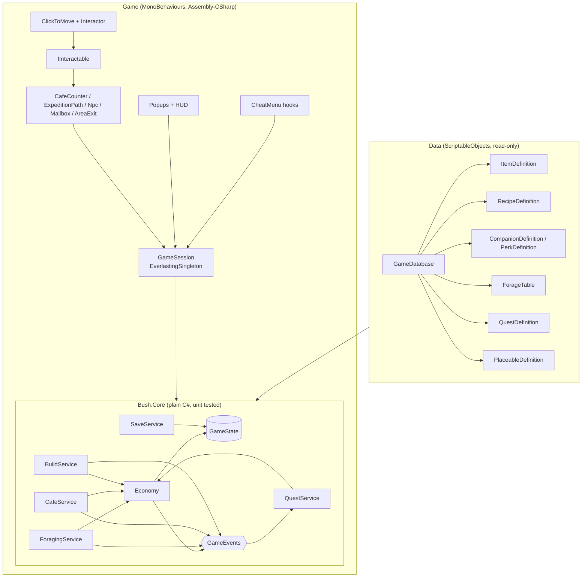

# Architecture (jam build)

How the game code is structured for the two-week jam. Sources: the GDD (v1.0), the Staged Production Plan (v2), the Trello Dev board and the Miro board. The aim is the small technical foundations from the production plan, not a framework: stable item IDs, one place that changes inventory and currency, quest state that can't pay out twice, local save tested early, and debug shortcuts.

**Rule of thumb:** game rules live in plain C# that can be unit tested. MonoBehaviours only show state and forward player input.

## Overview



## 1. Folders and assemblies

Game code goes into the template's existing folders (there is no separate `_Game` folder), with one subfolder per area. Template folders are marked *(template)*.

```
Assets/
  Scripts/
    Core/          Bush.Core.asmdef (pure C#, no UnityEngine): Model/ (design data), State/ (GameState),
                   Services/ (Economy, CafeService, QuestService, GameEvents), Foraging/, Design/ (JSON format, validator)
    Definitions/   ScriptableObject definitions (ItemDefinition...) + GameDatabase
    Editor/        DesignDataTools (import/export/validate), AreaSceneSetup
    Session/       AreaTravel, AreaInfo, SpawnPoint (later: GameSession, autosave)
    Camera/        CameraFit, CameraFollow
    Navigation/    WalkableGrid, IPathfinder, GridPathfinder
    Player/        CharacterMover, Interactor, PlayerPointerInput, InputLock
    Interaction/   IInteractable, Interactable, StandPoint, InteractionPrompt, AreaExit (later: stations, NPCs)
    Building/      build mode, placement, PlacedObject
    UI/            (template) popups and UI states, plus the game HUD and popups
    Debugging/     (template) cheat menu, plus the game's CheatMenu registrations
    Achievements/ Analytics/ Audio/ HighScores/ Managers/ Utils/   (template)
  Data/            definition assets, made by Tools > Bush > Import Design Data: Items/, Recipes/, Companions/,
                   Perks/, Focuses/, ForageTables/, Npcs/, Quests/ + GameDatabase.asset
  Input/           BushInput.inputactions (the one Input System asset)
  Scenes/          Cafe, Garden (+ Boot, and Village if kept); template scenes are in Scenes/Templates/
  Images/  Prefabs/  Audio/  Animations/
  Tests/EditMode/  Bush.Core.Tests.asmdef (rules); Tests/Editor/ for tests that need game scripts (navigation)
Design/            design-data.json: the design data the sandbox edits (outside Assets, so Unity ignores it)
Tools/ForageSandbox/  standalone web page for trying out foraging without Unity
```

Scripts in `Assembly-CSharp` sit in the global namespace like the template's (Rider's namespace-from-folder hint is switched off per folder in `Assembly-CSharp.csproj.DotSettings`). Never name a namespace after a Unity type such as `Camera`, because it hides that type from every script in the project.

**Why only one asmdef for the game:** the template scripts (singletons, `PopupManager`, `CheatMenu`, `SceneLoader`) have no assembly definition, so they compile into `Assembly-CSharp`, and an asmdef can't reference `Assembly-CSharp`. `Bush.Core` (in `Assets/Scripts/Core`, so it's a separate assembly even though it sits next to the other scripts) therefore holds only rules and state with no template dependencies, which is exactly the part worth testing. It goes one step further and has no UnityEngine reference at all (`noEngineReferences`), so its tests also run outside Unity. Everything that touches the template stays in `Assembly-CSharp`. Wrapping the template in asmdefs isn't worth the time during the jam.

Tests that need game scripts (like the navigation tests) live in an `Editor` folder without an asmdef, so they compile into `Assembly-CSharp-Editor`, which can see `Assembly-CSharp` and already references NUnit.

## 2. Data: definitions with stable IDs

Every definition is a ScriptableObject with a `string id` (e.g. `item.berries`, `recipe.worm_pie`) that never changes, even if the display name or art does. Saves and other data refer to things only by ID.

Each definition converts to a plain C# model in `Bush.Core` (`ItemDefinition.ToData()` gives an `ItemData`), and `GameDatabase.BuildDesign()` turns the whole database into one `DesignData`. The rules only ever run on `DesignData`, so they can be tested without Unity and the web sandbox can run the exact same rules. The assets keep the Unity-only parts (icons, portraits, prefabs).

| Definition | Key fields | Seed content |
| --- | --- | --- |
| `ItemDefinition` | id, displayName, icon, category, rarity, tags, sellValue, unique | 27 items: leaves, berries, worms, insects, fungi, bark, silk, shinies, 4 recipe scraps |
| `RecipeDefinition` | ingredients (item, qty), coins, unlockedByDefault, scraps | 11 recipes from the Miro list; 3 unlocked at the start |
| `CompanionDefinition` | portrait, modifiers, teachesPerk, tripsToTeach, unlockedByDefault | Kea, Weka, Pekapeka (starters); Kunekune pig, Spider (unlocked by quests) |
| `PerkDefinition` | icon, modifiers, unlockedByDefault | 7 perks: 3 at the start, 3 taught by companions, 1 quest reward |
| `FocusDefinition` | tags, multiplier | bugs and worms, greens, fruit and flowers, fungi and mud, bark and silk |
| `ForageTableDefinition` | rolls, entries (item, weight, min, max, time of day, requiresQuest) | `table.bush` |
| `NpcDefinition` | portrait, species | Ruru, Weka, Snail, Wētā |
| `QuestDefinition` | giver, isMain, prerequisites, objectives, rewards, 4 dialogue lines | 2 main quests + 3 side quests (see [MAIN-QUEST.md](MAIN-QUEST.md)) |
| `PlaceableDefinition` | item, prefab | none yet (Stage 6) |

**Item categories:** `Ingredient` (cooked), `Material` (bark, silk: quests and repairs), `Treasure` (shinies: trades and selling), `KeyItem` (quest items like recipe scraps: can't be cooked or sold), `Placeable` (build mode). They all live in the one inventory; the UI can filter by category, which also covers the GDD's "cafe larder" (see Open decisions). Items marked `unique` can only be owned once and never drop again once found.

**Where the data comes from:** the seed lives in [`Design/design-data.json`](../Design/design-data.json). **Tools > Bush > Import Design Data** creates or updates the assets in `Assets/Data` from it, matching by ID so icons and prefabs survive; it never deletes anything. **Export Design Data** writes the assets back to JSON, so a designer can tune in the [forage sandbox](../Tools/ForageSandbox/README.md) and the changes come straight back into Unity. **Validate Design Data** flags duplicate IDs, broken references, impossible forage entries and modifiers that can never do anything (the Trello card *Check item and reward consistency*); an EditMode test runs the same checks on `design-data.json`.

Per the Miro decision log, crafting placeables is out of scope. Placeables come from quest rewards or are bought with currency.

## 3. State: one serialisable `GameState`

```csharp
[Serializable] public class GameState {        // Assets/Scripts/Core/State/GameState.cs
    public int saveVersion;
    public int currency;
    public List<ItemStack> inventory;           // itemId + qty; definitions stay in data
    public List<string> everObtained;           // unique items ever owned, so scraps never drop twice
    public List<string> unlockedRecipes, unlockedPerks, unlockedCompanions;
    public List<CompanionProgress> companions;  // trips per companion, for learning perks
    public List<QuestProgress> quests;          // questId, status, event counters, rewardClaimed
    public List<PlacedObjectData> placed;       // placeableId, position, flipped
    public bool hasPendingExpedition;           // set on Go, cleared on claim: survives a refresh
    public PendingExpedition pendingExpedition; // id, seed, setup
    public int day; public float timeOfDay;
}
```

`GameState.CreateNew(design)` starts a game with the default unlocks. The gecko's colour pattern (GDD) is still to add.

Collections are lists rather than dictionaries so that `JsonUtility` can serialise them without adding Newtonsoft. Services build dictionaries from the lists when they load. The GDD's separate "cafe larder" can start as an item category filter on the one inventory, and be split out later only if playtesting shows it's needed.

## 4. Core services (plain C#)

- **Economy** *(built)*: the only code that changes inventory or currency. `Count`, `Has`, `Add`, `TryRemove`, `AddCurrency`, `TrySpend`, plus `TryTransact(Transaction)`, which checks everything first (repeated costs are totalled) and then applies all of it or none of it. Rejects zero or negative amounts and unknown items, and caps unique items at one. Raises `InventoryChanged` / `CurrencyChanged`.
- **ForagingService** *(built)*: `Resolve(design, setup, context, seed) → ForageResult`, a pure function following [FORAGING.md](FORAGING.md), plus `Preview` for the setup screen's odds. In the game: `Begin` (on Go: stores the setup and seed in the state), `ResolvePending` (for the results screen) and `Claim` (pays out exactly once, counts the companion trip and teaches its perk). The GDD's "dims for a few seconds" is purely visual: the result is fixed by the seed up front. The same seed gives the same result in the web sandbox.
- **CafeService** *(built)*: `CanCook(recipe, out missing)` (what's short, for the UI), `Cook(recipe)` via one transaction, and `GetScrapProgress(recipe)` for the recipe book. Plan Stage 4 deliberately has no customer simulation: serving a dish pays its coins.
- **QuestService** *(built)*: `CanStart` (prerequisites), `Start`, `GetStatus`, `GetProgress`, `GetDialogue`, `Claim`, `IsMainStoryComplete` (the win condition). Item objectives (`HaveItems`, `DeliverItems`) are checked against the inventory live; cooking, expeditions, talking and placing are counted from `GameEvents` while the quest is active. Stored states are `NotStarted`, `Active` and `Completed`; `ReadyToClaim` is worked out from the objectives, so spending a needed item drops a quest back to Active. `Claim` hands in `DeliverItems`, pays rewards and unlocks in one transaction and sets `rewardClaimed`, so it can't pay twice.
- **BuildService:** place / move / remove placeables. Placing takes the item out of the inventory and removing puts it back, both through Economy.
- **SaveService:** turns `GameState` into JSON with `saveVersion`. On a missing, unreadable or older save it falls back to a fresh state and logs it, rather than crashing. Storage sits behind `ISaveStorage`:
  - **Default:** the existing `Utils.FileUtils` (`persistentDataPath`, which is IndexedDB on WebGL).
  - **Fallback:** PlayerPrefs, if the hosted build doesn't keep the file after a refresh. Verify this on the real host early (Trello: *Test browser storage persistence*).
- **GameEvents** *(built)*: a small set of plain C# events (one instance per session, so tests don't share state). No event bus framework.

## 5. Game layer (MonoBehaviours)

- **GameSession** (`EverlastingSingleton`, lives in a `Boot` scene together with the template `PopupCanvas` and audio): creates the services, loads the save, and exposes the services to the scene. It autosaves after an expedition, a dish, a quest claim and leaving build mode, and also on `OnApplicationPause` / tab hidden, because the template already detects that for auto-pause.
- **Player:** click/tap to walk (per the GDD). `ClickToMove` walks the gecko along a path to the clicked point on the floor, with no jump (see [section 6](#6-world-camera-and-movement)). Clicks on UI are ignored. Clicking an `IInteractable` makes `Interactor` walk the gecko to it and interact on arrival. Prompts and highlights must work without hover, for touch screens.
- **IInteractable:** `string Prompt`, `bool CanInteract(ctx)`, `void Interact(ctx)`. Every interactive thing uses this one pattern:
  - `ExpeditionPath`: the path at the garden's edge, opens forage setup
  - `CafeCounter`: menu / cook
  - `Npc`: dialogue and quests
  - `Mailbox`: mail and quest intros
  - `AreaExit`: target scene + spawn id
- **Scenes and areas:**
  - `Boot` stays loaded the whole time.
  - Areas are loaded one at a time through the template `SceneLoader` / `SceneReference`. `AreaExit` passes a spawn-point ID.
  - The MVP is **Cafe (hub) + Garden**. Village NPCs can stand at the cafe until a separate village scene earns its place (plan Stage 1: add a second area only if needed).
- **UI:** game popups inherit the template `Popup`:
  - forage setup and forage result
  - cafe menu and inventory
  - dialogue, quest log and mail

  Setup screens tick `Pauses Game`, matching the GDD's "pauses while open". The HUD shows currency, the current objective and the time of day. Build mode is a session state, not a popup.
- **Time of day:** a simple `GameClock` (day count + 0-1 time) tints a Global Light 2D. Critter schedules are post-jam.
- **Debug:** `CheatMenu.AddButton` / `AddToggle` registrations for: grant item, set currency, complete or reset a quest, force a forage result, reset the save. They compile out of release builds, as the template already does.

## 6. World, camera and movement

How every area scene is laid out. The Cafe greybox (`Assets/Scenes/Cafe.unity`) is the reference.

**View:** a "stage" view with depth, not a side-scroller. There's a walkable floor band in front of the cafe, and the further up the screen something is, the further back it is. Objects can be placed at different depths.

**Screen sizes**
- The safe area, **19.2 × 10.8 units** (16:9), is always visible. Keep anything important inside it.
- The backdrop bleeds out to **24 × 14.4 units** (2400 × 1440 px at 100 PPU), which covers everything from 4:3 iPads to 20:9 phones. On a 2400 × 1440 art canvas the safe-area guides are at x 240 / 2160 and y 180 / 1260.
- All final art is 100 PPU. Placeholders can use any PPU and be scaled.

**Camera:** orthographic Main Camera at (0, 0, -10) with `CameraFit`, which sets `orthographicSize = max(safe.y / 2, safe.x / 2 / aspect)` so the whole safe area always fits, and draws it as a yellow gizmo. UI canvases use Canvas Scaler *Scale With Screen Size* at 1920 × 1080 with *Expand*, and the template **Safe Area** component for notches.

**Depth sorting:** `Default_2D_Renderer` uses Transparency Sort Mode *Custom Axis* (0, 1, 0), so lower on screen draws in front. Props and characters share the `World` sorting layer with Sprite Sort Point *Pivot*, and their pivots are at the feet.

| Sorting layers (back to front) | Physics layers |
| --- | --- |
| Background, Floor, FloorDecals, World, Foreground | Floor, Obstacle, Interactable, Player |

**Scene hierarchy:** `Systems`, `Main Camera`, `Global Light 2D`, `World` (a `Grid`, holding `Backdrop`, `Floor` with its `WalkableArea`, `Static` props, `Placed` props, `Characters`, `Foreground`, `Markers`), `HUD`, `EventSystem`.

**Props:** each prop is a parent object at its floor contact point (unscaled) with a `BoxCollider2D` footprint on the `Obstacle` layer, and a child `Visual` sprite that holds any scale.

**Walkable floor and pathfinding**
- `Floor/WalkableArea` is a trigger `PolygonCollider2D` outlining where the gecko can walk.
- `WalkableGrid` splits the World `Grid` into 0.25-unit cells. A cell is walkable if it's inside `WalkableArea` and doesn't overlap an `Obstacle` footprint. It draws green and red gizmos.
- `GridPathfinder` runs A* over the grid behind an `IPathfinder` interface, so it can be swapped for NavMeshPlus later. Paths are smoothed by line of sight, and clicking a blocked spot walks to the nearest walkable cell.
- `ClickToMove` uses a `Physics2DRaycaster` on the camera, so clicks on UI never move the gecko. The gecko faces the way it's walking.
- Interactables have a `StandPoint` child. Clicking one walks the gecko to the stand point and then calls `Interact()`.
- Build mode must not let the player place something that blocks the path to an exit or a key stand point.

## 7. Tests

EditMode tests in `Bush.Core.Tests` (`Assets/Tests/EditMode`, 42 tests) cover:
- the Economy edge cases from Trello list 05: zero or negative quantities, unknown items, not enough items, repeated costs, unique items, `TryTransact` never applying half a change
- foraging: same seed same result, roll counts, day/night and quest-gated entries, unique scraps (once per trip, never after being found), each modifier type, the odds preview, paying out exactly once, double-clicking Go, learning a companion's perk
- quests and cooking: prerequisites, counters only while active, claiming once, recipe scraps handed in together unlocking the recipe, dialogue per state
- design data: the validator, the JSON round trip, and that `Design/design-data.json` loads and validates
- still to add: a save written and loaded again comes back the same, and an unknown or old version falls back to a fresh state (with SaveService)

Because `Bush.Core` has no UnityEngine reference, these tests can also be compiled and run outside Unity.

Everything else is tested by playing the browser build, as the plan describes.

## 8. How this maps to the plan

| Plan stage / Trello list | Pieces built |
| --- | --- |
| 1 Movement and interaction / 03 | Boot + Cafe scenes, WalkableGrid + GridPathfinder, ClickToMove, Interactor, IInteractable, AreaExit |
| 2 Foraging / 04 | Item and forage-table data, ForagingService, companions/perks, forage setup + result popups |
| 3 Inventory, currency, save / 05 | GameState, Economy, SaveService, inventory UI, reset-save cheat |
| 4 Recipes and cafe / 06 | RecipeDefinition, CafeService, CafeCounter, menu popup |
| 5 Quests / 07 | QuestDefinition, QuestService, Npc, dialogue popup, Mailbox |
| 6 Building / 08 | PlaceableDefinition, BuildService, build mode, placed objects saved |
| 7 Integration / 09-12 | data validation tool, cheat hooks, autosave points, full-loop smoke test |

## Decisions

- **Movement:** click/tap to walk and interact, with no jump (the GDD wins over the original Trello 03 wording; the cards have been updated).
- **Foraging:** a paused expedition screen (companion, perk, focus), then a short dimmed wait, then a results screen. There's no walk-around gathering (Trello 04 has been reworked to match).
- **View:** a stage view with depth (see [section 6](#6-world-camera-and-movement)), not a side-scroller.
- **Folders:** game code goes into the template's existing `Assets/Scripts/...` folders, not a separate `_Game` folder.
- **Primary platform:** WebGL in desktop browsers for the jam. PC Standalone comes later.
- **Design data:** rules run on plain C# models in `Bush.Core`; ScriptableObjects are the editing and art layer. `Design/design-data.json` plus the web sandbox are a second way in for designers without Unity.
- **Quest items:** recipe scraps and other quest items are `KeyItem` items in the same inventory, `unique` so they can't duplicate or drop twice. A recipe made of scraps is unlocked by a quest that hands them in (see [MAIN-QUEST.md](MAIN-QUEST.md)).

## Open decisions

1. **Village scene:** a separate scene, or NPCs at the cafe for the jam.
2. **Larder:** one inventory with categories, or a separate larder. *Built as one inventory with categories for now (a proposal, not final): the UI can show Larder (ingredients), Materials, Treasures and Quest items as tabs. A separate larder would only change the UI and the save layout.*
3. **Expedition limits:** unlimited, per time of day, or with a cost (Trello card *Decide expedition limits or costs*).
