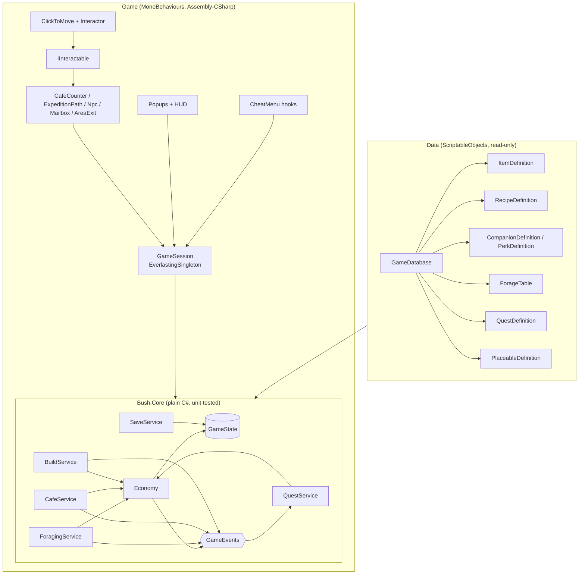

# Architecture (jam build)

How the game code is structured for the two-week jam. Sources: the GDD (v1.0), the Staged Production Plan (v2), the Trello Dev board and the Miro board. The aim is the small technical foundations from the production plan, not a framework: stable item IDs, one place that changes inventory and currency, quest state that can't pay out twice, local save tested early, and debug shortcuts.

**Rule of thumb:** game rules live in plain C# that can be unit tested. MonoBehaviours only show state and forward player input.

## Overview



## 1. Folders and assemblies

Game code goes into the template's existing folders (there is no separate `_Game` folder), with one subfolder per area. Template folders are marked *(template)*.

```
Assets/
  Scripts/
    Core/          Bush.Core.asmdef: GameState, Economy, services, events (no MonoBehaviours)
    Definitions/   ScriptableObject definition classes + GameDatabase
    Session/       GameSession, autosave, scene/area flow
    Camera/        CameraFit
    Navigation/    WalkableGrid, IPathfinder, GridPathfinder
    Player/        ClickToMove, Interactor
    Interaction/   IInteractable, StandPoint and the stations, NPCs and exits
    Building/      build mode, placement, PlacedObject
    UI/            (template) popups and UI states, plus the game HUD and popups
    Debugging/     (template) cheat menu, plus the game's CheatMenu registrations
    Achievements/ Analytics/ Audio/ HighScores/ Managers/ Utils/   (template)
  Data/            definition assets: Items/, Recipes/, Companions/, Perks/, ForageTables/, Quests/, Placeables/
  Scenes/          Cafe, Garden (+ Boot, and Village if kept); template scenes are in Scenes/Templates/
  Images/  Prefabs/  Audio/  Animations/
  Tests/EditMode/  Bush.Core.Tests.asmdef
```

Scripts in `Assembly-CSharp` sit in the global namespace like the template's (Rider's namespace-from-folder hint is switched off per folder in `Assembly-CSharp.csproj.DotSettings`). Never name a namespace after a Unity type such as `Camera`, because it hides that type from every script in the project.

**Why only one asmdef for the game:** the template scripts (singletons, `PopupManager`, `CheatMenu`, `SceneLoader`) have no assembly definition, so they compile into `Assembly-CSharp`, and an asmdef can't reference `Assembly-CSharp`. `Bush.Core` (in `Assets/Scripts/Core`, so it's a separate assembly even though it sits next to the other scripts) therefore holds only rules and state with no template dependencies, which is exactly the part worth testing. Everything that touches the template stays in `Assembly-CSharp`. Wrapping the template in asmdefs isn't worth the time during the jam.

## 2. Data: definitions with stable IDs

Every definition is a ScriptableObject with a `string id` (e.g. `item.berry`, `recipe.worm_pie`) that never changes, even if the display name or art does. Saves and other data refer to things only by ID.

| Definition | Key fields | Seed content (from Miro) |
| --- | --- | --- |
| `ItemDefinition` | id, displayName, icon, category (Ingredient / Rare / Placeable), tags, sellValue | worms, berries, leaves, bark, silk, shiny things, mushrooms |
| `RecipeDefinition` | id, ingredients[(itemId, qty)], coinReward, unlockedByDefault | leaf salad, worm pie, berry cake |
| `CompanionDefinition` | id, name, portrait, perk | kea (beak hammer: +bark), weka (steals: + chance of a shiny), pekapeka (sees in the dark: + insects) |
| `PerkDefinition` | id, effect type (bonus tag, extra roll, rarity boost), value | |
| `ForageTable` | weighted entries (itemId, weight, min-max qty, rarity) | |
| `QuestDefinition` | id, giver NPC id, dialogue lines, objectives[], rewards[], prerequisite quest | one short main chain |
| `PlaceableDefinition` | itemId, prefab, footprint | a handful of cafe decorations |

A `GameDatabase` asset lists all of them and builds ID lookups at runtime. An editor menu item, **Tools > Bush > Validate Data**, flags duplicate IDs, missing references and recipes or quests that point at item IDs that don't exist. That covers the Trello card *Check item and reward consistency*.

Per the Miro decision log, crafting placeables is out of scope. Placeables come from quest rewards or are bought with currency.

## 3. State: one serialisable `GameState`

```csharp
[Serializable] public class GameState {
    public int saveVersion;
    public int currency;
    public List<ItemStack> inventory;        // itemId + qty; definitions stay in data
    public List<string> unlockedRecipes;
    public List<QuestProgress> quests;       // questId, state, objective counts, rewardClaimed
    public List<PlacedObjectData> placed;    // placeableId, position, flipped
    public PlayerAppearance appearance;      // gecko colour pattern
    public int day; public float timeOfDay;
}
```

Collections are lists rather than dictionaries so that `JsonUtility` can serialise them without adding Newtonsoft. Services build dictionaries from the lists when they load. The GDD's separate "cafe larder" can start as an item category filter on the one inventory, and be split out later only if playtesting shows it's needed.

## 4. Core services (plain C#)

- **Economy:** the only code that changes inventory or currency. `Has`, `Add`, `TryRemove`, `TrySpend`, plus `TryTransact(costs, rewards)`, which checks everything first and then applies all of it or none of it. Cooking, quest turn-ins, buying and rewards all go through it. Raises `ItemsChanged` / `CurrencyChanged`.
- **ForagingService:** `Resolve(ExpeditionSetup setup, IRandom rng) → ForageResult`. A pure function of the forage table, companion and perks, plus an injected random source. That makes it testable and lets the cheat menu force results. The GDD's duration ("dims for a few seconds") is purely visual: the result is decided up front and then revealed.
- **CafeService:** `CanCook(recipe)` (also returns what's missing for the UI) and `Cook(recipe)` via `TryTransact`. Plan Stage 4 deliberately has no customer simulation: serving a dish pays its `coinReward`.
- **QuestService:** listens to `GameEvents` (items changed, dish cooked, expedition finished, object placed) and updates objective counts. States are `NotStarted → Active → ReadyToClaim → Completed`. `Claim` checks and sets `rewardClaimed` in the same call, so a reward can't be paid twice.
- **BuildService:** place / move / remove placeables. Placing takes the item out of the inventory and removing puts it back, both through Economy.
- **SaveService:** turns `GameState` into JSON with `saveVersion`. On a missing, unreadable or older save it falls back to a fresh state and logs it, rather than crashing. Storage sits behind `ISaveStorage`:
  - **Default:** the existing `Utils.FileUtils` (`persistentDataPath`, which is IndexedDB on WebGL).
  - **Fallback:** PlayerPrefs, if the hosted build doesn't keep the file after a refresh. Verify this on the real host early (Trello: *Test browser storage persistence*).
- **GameEvents:** a small set of plain C# events. No event bus framework.

## 5. Game layer (MonoBehaviours)

- **GameSession** (`EverlastingSingleton`, lives in a `Boot` scene together with the template `PopupCanvas` and audio): creates the services, loads the save, and exposes the services to the scene. It autosaves after an expedition, a dish, a quest claim and leaving build mode, and also on `OnApplicationPause` / tab hidden, because the template already detects that for auto-pause.
- **Player** *(built)*: click/tap to walk (per the GDD), on the gecko:
  - `PlayerPointerInput` reads the Gameplay map of `Assets/Input/BushInput.inputactions` (Point + Click; Escape/pause stays in the template's `PauseInput`). It ignores presses on UI, while a popup or the cheat menu is open, and while `InputLock` is held (e.g. during area transitions). Holding the button keeps steering.
  - `CharacterMover` walks along the path from the area's `IPathfinder`, faces the way it's going (flips the `Visual` child) and stops cleanly. A new click mid-walk replaces the path. Optional Animator parameters `Speed` and `Walking`.
  - `Interactor` walks to an interactable's stand point and interacts on arrival; clicking elsewhere on the way cancels it.
- **IInteractable** *(built)*: `Prompt`, `CanInteract(ctx)`, `Interact(ctx)`, `GetStandPosition(from)`, `SetHovered`, `SetTargeted`. The `Interactable` base class does the common parts (stand points, an `onInteract` UnityEvent, a log line) and `InteractionPrompt` shows a bobbing marker when the gecko is nearby, plus a highlight and the prompt text when hovered (mouse) or being walked to, so it works on touch. Every interactive thing uses this one pattern:
  - `AreaExit` *(built)*: target scene + spawn id
  - `ExpeditionPath`: the path at the garden's edge, opens forage setup
  - `CafeCounter`: menu / cook
  - `Npc`: dialogue and quests
  - `Mailbox`: mail and quest intros
- **Scenes and areas:**
  - `Boot` stays loaded the whole time.
  - Areas are loaded one at a time by `AreaTravel` *(built)*: fade out, load, place the gecko on the `SpawnPoint` the `AreaExit` named, fade in, then show the area's name from its `AreaInfo` so it's clear where the player is. Input is locked throughout and a second request is ignored. It creates its own overlay, so it needs no setup. (It uses `SceneManager` with `SceneReference` directly; the template `SceneLoader` is built around additive scenes and display names, which we don't need.)
  - Getting stuck: the cheat menu has "back to the spawn point" and "return to the cafe", and the template pause menu's Main Menu button loads the first scene in the build list (the cafe, until there's a title screen).
  - The MVP is **Cafe (hub) + Garden**. Village NPCs can stand at the cafe until a separate village scene earns its place (plan Stage 1: add a second area only if needed).
- **UI:** game popups inherit the template `Popup`:
  - forage setup and forage result
  - cafe menu and inventory
  - dialogue, quest log and mail

  Setup screens tick `Pauses Game`, matching the GDD's "pauses while open". The HUD shows currency, the current objective and the time of day. Build mode is a session state, not a popup.
- **Time of day:** a simple `GameClock` (day count + 0-1 time) tints a Global Light 2D. Critter schedules are post-jam.
- **Debug:** `CheatMenu.AddButton` / `AddToggle` registrations for: grant item, set currency, complete or reset a quest, force a forage result, reset the save. They compile out of release builds, as the template already does.

## 6. World, camera and movement

How every area scene is laid out. The Cafe greybox (`Assets/Scenes/Cafe.unity`) is the reference.

**View:** a "stage" view with depth, not a side-scroller. There's a walkable floor band in front of the cafe, and the further up the screen something is, the further back it is. Objects can be placed at different depths.

**Screen sizes**
- The safe area, **19.2 × 10.8 units** (16:9), is always visible. Keep anything important inside it.
- The backdrop bleeds out to **24 × 14.4 units** (2400 × 1440 px at 100 PPU), which covers everything from 4:3 iPads to 20:9 phones. On a 2400 × 1440 art canvas the safe-area guides are at x 240 / 2160 and y 180 / 1260.
- All final art is 100 PPU. Placeholders can use any PPU and be scaled.

**Camera:** orthographic Main Camera at (0, 0, -10) with `CameraFit`, which sets `orthographicSize = max(safe.y / 2, safe.x / 2 / aspect)` so the whole safe area always fits, and draws it as a yellow gizmo. UI canvases use Canvas Scaler *Scale With Screen Size* at 1920 × 1080 with *Expand*, and the template **Safe Area** component for notches.

**Depth sorting:** `Default_2D_Renderer` uses Transparency Sort Mode *Custom Axis* (0, 1, 0), so lower on screen draws in front. Props and characters share the `World` sorting layer with Sprite Sort Point *Pivot*, and their pivots are at the feet.

| Sorting layers (back to front) | Physics layers |
| --- | --- |
| Background, Floor, FloorDecals, World, Foreground | Floor, Obstacle, Interactable, Player |

**Scene hierarchy:** `Systems`, `Main Camera`, `Global Light 2D`, `World` (a `Grid`, holding `Backdrop`, `Floor` with its `WalkableArea`, `Static` props, `Placed` props, `Characters`, `Foreground`, `Markers`), `HUD`, `EventSystem`.

**Props:** each prop is a parent object at its floor contact point (unscaled) with a `BoxCollider2D` footprint on the `Obstacle` layer, and a child `Visual` sprite that holds any scale.

**Walkable floor and pathfinding**
- `Floor/WalkableArea` is a trigger `PolygonCollider2D` outlining where the gecko can walk.
- `WalkableGrid` splits the World `Grid` into 0.25-unit cells. A cell is walkable if it's inside `WalkableArea` and doesn't overlap an `Obstacle` footprint. It draws green and red gizmos.
- `GridPathfinder` runs A* over the grid behind an `IPathfinder` interface, so it can be swapped for NavMeshPlus later. Paths are smoothed by line of sight, and clicking a blocked spot walks to the nearest walkable cell.
- `PlayerPointerInput` checks the UI first (an EventSystem raycast that only counts `GraphicRaycaster` hits), so clicks on UI never move the gecko. Then it looks for interactable colliders at the point (layer `Interactable`, triggers included), picking the front-most one (lowest on screen) and allowing a small radius for fingers. Anything else walks to the closest reachable point, so clicking the sky or a prop still does something sensible. This replaces the planned `Physics2DRaycaster` approach, whose hit order between overlapping world colliders depends on renderers and isn't predictable; the camera's `Physics2DRaycaster` isn't needed.
- Interactables have one or more `StandPoint` children on the floor; the closest one is used. An interactable needs a collider on the `Interactable` layer covering what the player sees (a child called `Click`, separate from its `Obstacle` footprint).
- `CameraFollow` is for areas bigger than one screen: it follows the gecko and clamps to the area bounds. The cafe fits in the safe area, so it doesn't use it.
- **Tools > Bush > Set Up Area Scene** adds all of the above to an area scene laid out like the cafe (and a placeholder counter, exit, spawn point and the pause menu if they're missing). See [FIRST-PLAYABLE.md](FIRST-PLAYABLE.md).
- Build mode must not let the player place something that blocks the path to an exit or a key stand point.

## 7. Tests

EditMode tests in `Bush.Core.Tests` cover:
- the Economy edge cases from Trello list 05: zero or negative quantities, not enough items, `TryTransact` never applying half a change
- a quest reward can't be claimed twice
- a save written and loaded again comes back the same, and an unknown or old version falls back to a fresh state
- `ForagingService` gives the same result for the same seed

Everything else is tested by playing the browser build, as the plan describes.

## 8. How this maps to the plan

| Plan stage / Trello list | Pieces built |
| --- | --- |
| 1 Movement and interaction / 03 | Cafe scene, WalkableGrid + GridPathfinder, PlayerPointerInput + CharacterMover, Interactor, IInteractable + InteractionPrompt, AreaExit + AreaTravel *(all built; Garden scene and Boot still to make)* |
| 2 Foraging / 04 | Item and forage-table data, ForagingService, companions/perks, forage setup + result popups |
| 3 Inventory, currency, save / 05 | GameState, Economy, SaveService, inventory UI, reset-save cheat |
| 4 Recipes and cafe / 06 | RecipeDefinition, CafeService, CafeCounter, menu popup |
| 5 Quests / 07 | QuestDefinition, QuestService, Npc, dialogue popup, Mailbox |
| 6 Building / 08 | PlaceableDefinition, BuildService, build mode, placed objects saved |
| 7 Integration / 09-12 | data validation tool, cheat hooks, autosave points, full-loop smoke test |

## Decisions

- **Movement:** click/tap to walk and interact, with no jump (the GDD wins over the original Trello 03 wording; the cards have been updated).
- **Foraging:** a paused expedition screen (companion, perk, focus), then a short dimmed wait, then a results screen. There's no walk-around gathering (Trello 04 has been reworked to match).
- **View:** a stage view with depth (see [section 6](#6-world-camera-and-movement)), not a side-scroller.
- **Folders:** game code goes into the template's existing `Assets/Scripts/...` folders, not a separate `_Game` folder.
- **Primary platform:** WebGL in desktop browsers for the jam. PC Standalone comes later.

## Open decisions

1. **Village scene:** a separate scene, or NPCs at the cafe for the jam.
2. **Larder:** one inventory with categories, or a separate larder.
3. **Expedition limits:** unlimited, per time of day, or with a cost (Trello card *Decide expedition limits or costs*).
