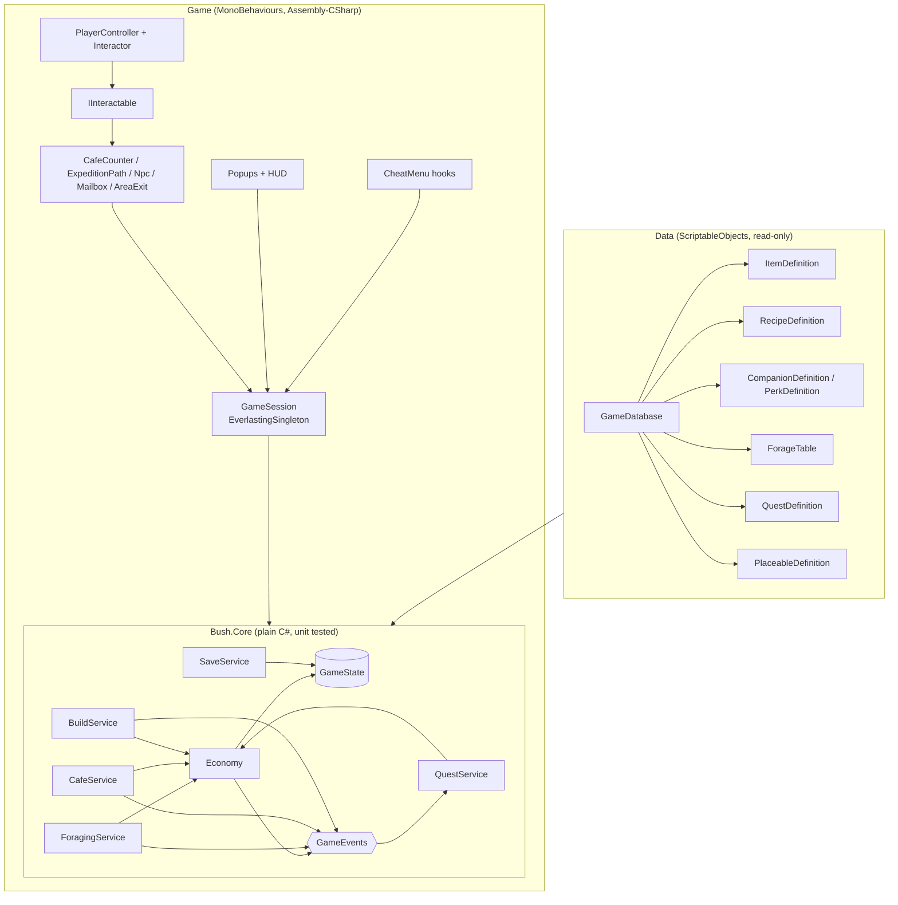

# Architecture (jam build)

How the game code is structured for the two-week jam. Sources: the GDD (v1.0), the Staged Production Plan (v2), the Trello Dev board and the Miro board. The aim is the small technical foundations from the production plan, not a framework: stable item IDs, one place that changes inventory and currency, quest state that can't pay out twice, local save tested early, and debug shortcuts.

**Rule of thumb:** game rules live in plain C# that can be unit tested. MonoBehaviours only show state and forward player input.

## Overview



## 1. Folders and assemblies

Game code goes under `Assets/_Game/` so it stays separate from the template code (`Assets/Scripts`, `Assets/Prefabs`, ...). The underscore keeps it at the top of the Project window.

```
Assets/_Game/
  Scripts/
    Core/          Bush.Core.asmdef: GameState, Economy, services, events (no MonoBehaviours)
    Data/          ScriptableObject definition classes + GameDatabase
    Session/       GameSession, autosave, scene/area flow
    Player/        movement, Interactor
    Interaction/   IInteractable and its implementations (stations, NPCs, exits)
    Building/      build mode, placement grid, PlacedObject
    UI/            HUD and game popups (built on the template Popup)
    DebugTools/    CheatMenu registrations
  Data/            Items/, Recipes/, Companions/, Perks/, ForageTables/, Quests/, Placeables/
  Scenes/          Boot, Cafe, Garden (+ Village if kept)
  Prefabs/  Art/  Audio/
  Tests/EditMode/  Bush.Core.Tests.asmdef
```

**Why only one asmdef for the game:** the template scripts (singletons, `PopupManager`, `CheatMenu`, `SceneLoader`) have no assembly definition, so they compile into `Assembly-CSharp`, and an asmdef can't reference `Assembly-CSharp`. `Bush.Core` therefore holds only rules and state with no template dependencies, which is exactly the part worth testing. Everything that touches the template stays in `Assembly-CSharp`. Wrapping the template in asmdefs isn't worth the time during the jam.

## 2. Data: definitions with stable IDs

Every definition is a ScriptableObject with a `string id` (e.g. `item.berry`, `recipe.worm_pie`) that never changes, even if the display name or art does. Saves and other data refer to things only by ID.

| Definition | Key fields | Seed content (from Miro) |
| --- | --- | --- |
| `ItemDefinition` | id, displayName, icon, category (Ingredient / Rare / Placeable), tags, sellValue | worms, berries, leaves, bark, silk, shiny things, mushrooms |
| `RecipeDefinition` | id, ingredients[(itemId, qty)], coinReward, unlockedByDefault | leaf salad, worm pie, berry cake |
| `CompanionDefinition` | id, name, portrait, perk | kea (beak hammer: +bark), weka (steals: + chance of a shiny), pekapeka (sees in the dark: + insects) |
| `PerkDefinition` | id, effect type (bonus tag, extra roll, rarity boost), value | |
| `ForageTable` | weighted entries (itemId, weight, min-max qty, rarity) | |
| `QuestDefinition` | id, giver NPC id, dialogue lines, objectives[], rewards[], prerequisite quest | one short main chain |
| `PlaceableDefinition` | itemId, prefab, footprint | a handful of cafe decorations |

A `GameDatabase` asset lists all of them and builds ID lookups at runtime. An editor menu item, **Tools > Bush > Validate Data**, flags duplicate IDs, missing references and recipes or quests that point at item IDs that don't exist. That covers the Trello card *Check item and reward consistency*.

Per the Miro decision log, crafting placeables is out of scope. Placeables come from quest rewards or are bought with currency.

## 3. State: one serialisable `GameState`

```csharp
[Serializable] public class GameState {
    public int saveVersion;
    public int currency;
    public List<ItemStack> inventory;        // itemId + qty; definitions stay in data
    public List<string> unlockedRecipes;
    public List<QuestProgress> quests;       // questId, state, objective counts, rewardClaimed
    public List<PlacedObjectData> placed;    // placeableId, position, flipped
    public PlayerAppearance appearance;      // gecko colour pattern
    public int day; public float timeOfDay;
}
```

Collections are lists rather than dictionaries so that `JsonUtility` can serialise them without adding Newtonsoft. Services build dictionaries from the lists when they load. The GDD's separate "cafe larder" can start as an item category filter on the one inventory, and be split out later only if playtesting shows it's needed.

## 4. Core services (plain C#)

- **Economy:** the only code that changes inventory or currency. `Has`, `Add`, `TryRemove`, `TrySpend`, plus `TryTransact(costs, rewards)`, which checks everything first and then applies all of it or none of it. Cooking, quest turn-ins, buying and rewards all go through it. Raises `ItemsChanged` / `CurrencyChanged`.
- **ForagingService:** `Resolve(ExpeditionSetup setup, IRandom rng) → ForageResult`. A pure function of the forage table, companion and perks, plus an injected random source. That makes it testable and lets the cheat menu force results. The GDD's duration ("dims for a few seconds") is purely visual: the result is decided up front and then revealed.
- **CafeService:** `CanCook(recipe)` (also returns what's missing for the UI) and `Cook(recipe)` via `TryTransact`. Plan Stage 4 deliberately has no customer simulation: serving a dish pays its `coinReward`.
- **QuestService:** listens to `GameEvents` (items changed, dish cooked, expedition finished, object placed) and updates objective counts. States are `NotStarted → Active → ReadyToClaim → Completed`. `Claim` checks and sets `rewardClaimed` in the same call, so a reward can't be paid twice.
- **BuildService:** place / move / remove placeables. Placing takes the item out of the inventory and removing puts it back, both through Economy.
- **SaveService:** turns `GameState` into JSON with `saveVersion`. On a missing, unreadable or older save it falls back to a fresh state and logs it, rather than crashing. Storage sits behind `ISaveStorage`:
  - **Default:** the existing `Utils.FileUtils` (`persistentDataPath`, which is IndexedDB on WebGL).
  - **Fallback:** PlayerPrefs, if the hosted build doesn't keep the file after a refresh. Verify this on the real host early (Trello: *Test browser storage persistence*).
- **GameEvents:** a small set of plain C# events. No event bus framework.

## 5. Game layer (MonoBehaviours)

- **GameSession** (`EverlastingSingleton`, lives in a `Boot` scene together with the template `PopupCanvas` and audio): creates the services, loads the save, and exposes the services to the scene. It autosaves after an expedition, a dish, a quest claim and leaving build mode, and also on `OnApplicationPause` / tab hidden, because the template already detects that for auto-pause.
- **Player:** click/tap to walk (per the GDD). `PlayerController` moves the gecko along each area's walkable ground to the clicked point, with no jump. Clicks on UI are ignored. Clicking an `IInteractable` makes `Interactor` walk the gecko to it and interact on arrival. Prompts and highlights must work without hover, for touch screens.
- **IInteractable:** `string Prompt`, `bool CanInteract(ctx)`, `void Interact(ctx)`. Every interactive thing uses this one pattern:
  - `ExpeditionPath`: the path at the garden's edge, opens forage setup
  - `CafeCounter`: menu / cook
  - `Npc`: dialogue and quests
  - `Mailbox`: mail and quest intros
  - `AreaExit`: target scene + spawn id
- **Scenes and areas:**
  - `Boot` stays loaded the whole time.
  - Areas are loaded one at a time through the template `SceneLoader` / `SceneReference`. `AreaExit` passes a spawn-point ID.
  - The MVP is **Cafe (hub) + Garden**. Village NPCs can stand at the cafe until a separate village scene earns its place (plan Stage 1: add a second area only if needed).
- **UI:** game popups inherit the template `Popup`:
  - forage setup and forage result
  - cafe menu and inventory
  - dialogue, quest log and mail

  Setup screens tick `Pauses Game`, matching the GDD's "pauses while open". The HUD shows currency, the current objective and the time of day. Build mode is a session state, not a popup.
- **Time of day:** a simple `GameClock` (day count + 0-1 time) tints a Global Light 2D. Critter schedules are post-jam.
- **Debug:** `CheatMenu.AddButton` / `AddToggle` registrations for: grant item, set currency, complete or reset a quest, force a forage result, reset the save. They compile out of release builds, as the template already does.

## 6. Tests

EditMode tests in `Bush.Core.Tests` cover:
- the Economy edge cases from Trello list 05: zero or negative quantities, not enough items, `TryTransact` never applying half a change
- a quest reward can't be claimed twice
- a save written and loaded again comes back the same, and an unknown or old version falls back to a fresh state
- `ForagingService` gives the same result for the same seed

Everything else is tested by playing the browser build, as the plan describes.

## 7. How this maps to the plan

| Plan stage / Trello list | Pieces built |
| --- | --- |
| 1 Movement and interaction / 03 | Boot + Cafe scenes, PlayerController, Interactor, IInteractable, AreaExit |
| 2 Foraging / 04 | Item and forage-table data, ForagingService, companions/perks, forage setup + result popups |
| 3 Inventory, currency, save / 05 | GameState, Economy, SaveService, inventory UI, reset-save cheat |
| 4 Recipes and cafe / 06 | RecipeDefinition, CafeService, CafeCounter, menu popup |
| 5 Quests / 07 | QuestDefinition, QuestService, Npc, dialogue popup, Mailbox |
| 6 Building / 08 | PlaceableDefinition, BuildService, build mode, placed objects saved |
| 7 Integration / 09-12 | data validation tool, cheat hooks, autosave points, full-loop smoke test |

## Decisions

- **Movement:** click/tap to walk and interact, with no jump (the GDD wins over the original Trello 03 wording; the cards have been updated).
- **Foraging:** a paused expedition screen (companion, perk, focus), then a short dimmed wait, then a results screen. There's no walk-around gathering (Trello 04 has been reworked to match).
- **Primary platform:** WebGL in desktop browsers for the jam. PC Standalone comes later.

## Open decisions

1. **Village scene:** a separate scene, or NPCs at the cafe for the jam.
2. **Larder:** one inventory with categories, or a separate larder.
3. **Expedition limits:** unlimited, per time of day, or with a cost (Trello card *Decide expedition limits or costs*).
