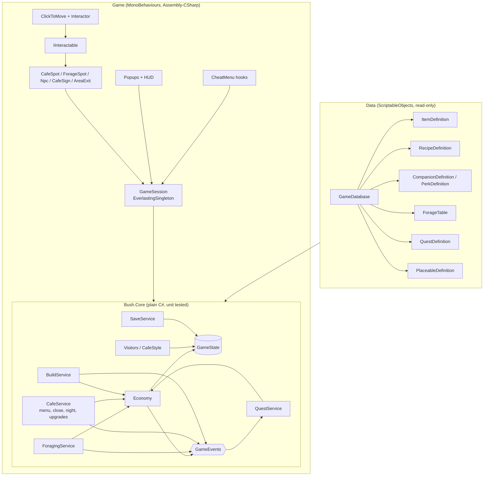

# Architecture (jam build)

How the game code is structured for the two-week jam. Sources: the GDD (v1.0), the Staged Production Plan (v2), the Trello Dev board and the Miro board. The aim is the small technical foundations from the production plan, not a framework: stable item IDs, one place that changes inventory and currency, quest state that can't pay out twice, local save tested early, and debug shortcuts.

**Rule of thumb:** game rules live in plain C# that can be unit tested. MonoBehaviours only show state and forward player input.

## Overview



## 1. Folders and assemblies

Game code goes into the template's existing folders (there is no separate `_Game` folder), with one subfolder per area. Template folders are marked *(template)*.

```
Assets/
  Scripts/
    Core/          Bush.Core.asmdef (pure C#, no UnityEngine): Model/ (design data), State/ (GameState),
                   Services/ (Economy, CafeService, QuestService, BuildService, Visitors, CafeStyle, QuestText,
                   GameEvents), Foraging/ (+ ModifierText), Design/ (JSON format, validator)
    Definitions/   ScriptableObject definitions (ItemDefinition...) + GameDatabase
    Editor/        DesignDataTools (import/export/validate), AreaSceneSetup
    Session/       GameSession (+ bootstrap), SaveService, AreaTravel, AreaInfo, SpawnPoint,
                   DayTransition, DayFlow, DayNightLighting, NightLight
    Camera/        CameraFit, CameraFollow
    Navigation/    WalkableGrid, IPathfinder, GridPathfinder
    Player/        CharacterMover, Interactor, PlayerPointerInput, InputLock
    Interaction/   IInteractable, Interactable, StandPoint, InteractionPrompt, AreaExit, Npc, GuestSeating,
                   CafeSpot, ForageSpot, CafeSign
    Building/      BuildArea, BuildMode, PlacementValidator, PlacedObject, SeatPoint
    UI/            (template) popups and UI states, plus GameUi (code-built prototype UI), GameHud, BuildUi,
                   InventoryPopup (the bag), ItemGridView, UiPointer, ForagePopup, CafePopup, UpgradesPopup,
                   RecipeShopPopup, CafeSignPopup, DialogueBox, QuestLogPopup, DayDial
    Debugging/     (template) cheat menu, plus the game's CheatMenu registrations
    Achievements/ Analytics/ Audio/ HighScores/ Managers/ Utils/   (template)
  Data/            definition assets, made by Tools > Bush > Import Design Data: Items/, Recipes/, Companions/,
                   Perks/, Focuses/, ForageTables/, Npcs/, Quests/, Placeables/, Upgrades/ + GameDatabase.asset
                   (which also holds the day loop tuning)
  Input/           BushInput.inputactions (the one Input System asset)
  Scenes/          Cafe, Garden (+ Boot, and Village if kept); template scenes are in Scenes/Templates/
  Images/  Prefabs/  Audio/  Animations/
  Tests/EditMode/  Bush.Core.Tests.asmdef (rules); Tests/Editor/ for tests that need game scripts (navigation)
Design/            design-data.json: the design data the sandbox edits (outside Assets, so Unity ignores it)
Tools/ForageSandbox/  standalone web page for trying out foraging without Unity
```

Scripts in `Assembly-CSharp` sit in the global namespace like the template's (Rider's namespace-from-folder hint is switched off per folder in `Assembly-CSharp.csproj.DotSettings`). Never name a namespace after a Unity type such as `Camera`, because it hides that type from every script in the project.

**Why only one asmdef for the game:** the template scripts (singletons, `PopupManager`, `CheatMenu`, `SceneLoader`) have no assembly definition, so they compile into `Assembly-CSharp`, and an asmdef can't reference `Assembly-CSharp`. `Bush.Core` (in `Assets/Scripts/Core`, so it's a separate assembly even though it sits next to the other scripts) therefore holds only rules and state with no template dependencies, which is exactly the part worth testing. It goes one step further and has no UnityEngine reference at all (`noEngineReferences`), so its tests also run outside Unity. Everything that touches the template stays in `Assembly-CSharp`. Wrapping the template in asmdefs isn't worth the time during the jam.

Tests that need game scripts (like the navigation tests) live in an `Editor` folder without an asmdef, so they compile into `Assembly-CSharp-Editor`, which can see `Assembly-CSharp` and already references NUnit.

## 2. Data: definitions with stable IDs

Every definition is a ScriptableObject with a `string id` (e.g. `item.berries`, `recipe.worm_pie`) that never changes, even if the display name or art does. Saves and other data refer to things only by ID.

Each definition converts to a plain C# model in `Bush.Core` (`ItemDefinition.ToData()` gives an `ItemData`), and `GameDatabase.BuildDesign()` turns the whole database into one `DesignData`. The rules only ever run on `DesignData`, so they can be tested without Unity and the web sandbox can run the exact same rules. The assets keep the Unity-only parts (icons, portraits, prefabs).

| Definition | Key fields | Seed content |
| --- | --- | --- |
| `ItemDefinition` | id, displayName, icon, category, rarity, tags, sellValue, unique, teachesRecipe | 38 items: ingredients, materials, shinies, 4 recipe scraps, 4 rare recipe encounters, 6 placeables |
| `RecipeDefinition` | ingredients (item, qty), coins, unlockedByDefault, price (coins to learn), scraps | 16 recipes: none known at the start; from quests, encounters and Kererū's shop |
| `CompanionDefinition` | portrait, modifiers, teachesPerk, tripsToTeach, tripCost, activeAt (day/night/both) | Kea, Weka, Pekapeka (starter quests); Kunekune pig, Spider (side quests). None at the start |
| `PerkDefinition` | icon, modifiers, unlockedByDefault | 9 perks: 5 taught by companions, 4 late quest rewards. None at the start |
| `FocusDefinition` | tags, multiplier | bugs and worms, greens, fruit and flowers, fungi and mud, bark and silk |
| `ForageTableDefinition` | rolls, entries (item, weight, min, max, time of day, requiresQuest, requiresCompanion) | `table.bush` |
| `NpcDefinition` | portrait, species, visits (always/story/random), visitChance, firstDay, afterQuest, activeAt, shop | Ruru, Weka, Snail, Wētā, Kea, Pekapeka, Kererū (placeholders) |
| `QuestDefinition` | giver, isMain, prerequisites, objectives, rewards, 4 dialogue lines | 7 main quests (tutorial to the lost recipe), 3 side quests, 3 companion starter quests (see [MAIN-QUEST.md](MAIN-QUEST.md)) |
| `PlaceableDefinition` | item, prefab, placement type, footprint size, can flip, tray category, seats, cosiness, style | chair, cafe table, bench, potted fern, flower barrel, lantern post |
| `UpgradeDefinition` | effect (menu slot, daily sale, forage trip, perk slot), amount, price, requires | 7 cafe upgrades, 150 to 900 coins |

**Item categories:** `Ingredient` (cooked), `Material` (bark, silk: quests and repairs), `Treasure` (shinies: trades and selling), `KeyItem` (quest items like recipe scraps: can't be cooked or sold), `Placeable` (build mode). They all live in the one inventory; the UI can filter by category, which also covers the GDD's "cafe larder" (see Open decisions). Items marked `unique` can only be owned once, and once collected (owned, or handed in for a quest) they never drop or get rewarded again. Key items can only leave the inventory through a quest hand-in, so a quest item can't be lost, sold or cooked by mistake.

**Where the data comes from:** the seed lives in [`Design/design-data.json`](../Design/design-data.json). **Tools > Bush > Import Design Data** creates or updates the assets in `Assets/Data` from it, matching by ID so icons and prefabs survive; it never deletes anything. **Export Design Data** writes the assets back to JSON, so a designer can tune in the [forage sandbox](../Tools/ForageSandbox/README.md) and the changes come straight back into Unity. **Validate Design Data** flags duplicate IDs, broken references, impossible forage entries and modifiers that can never do anything (the Trello card *Check item and reward consistency*); an EditMode test runs the same checks on `design-data.json`.

**Rare encounters:** an item with `teachesRecipe` set (a unique key item) teaches that recipe the moment the player gets it, from foraging or a reward. The seed has four: *Kiwi's late-night note* (night only) teaches glowworm jelly, *A muddy recipe scribble* (only with Kunekune) teaches truffle toast, *Weka's pinched menu card* (with Weka) teaches beetlejuice, and *Tūī's golden song* (very rare, likelier with a Sweet focus) teaches pōhutukawa biscuits. `Economy` does the unlocking, so it works however the item arrives, and raises `GameEvents.RecipeLearned`.

Per the Miro decision log, crafting placeables is out of scope. Placeables come from quest rewards (and later rare finds).

## 3. State: one serialisable `GameState`

```csharp
[Serializable] public class GameState {        // Assets/Scripts/Core/State/GameState.cs
    public int saveVersion;
    public int currency;
    public List<ItemStack> inventory;           // itemId + qty; definitions stay in data
    public List<string> handedIn;               // unique items handed in for quests (with the inventory: what's collected)
    public List<string> unlockedRecipes, unlockedPerks, unlockedCompanions;
    public List<CompanionProgress> companions;  // trips per companion, for learning perks
    public List<QuestProgress> quests;          // questId, status, event counters, rewardClaimed
    public List<PlacedObjectData> placed;       // placeableId, position, flipped
    public bool hasPendingExpedition;           // set on Go, cleared on claim: survives a refresh
    public PendingExpedition pendingExpedition; // id, seed, a copy of the setup, and the result
    public int day; public List<string> menu;    // the day and today's menu
    public int forageTripsToday, nightTripsToday; public List<string> companionsUsedToday;
    public bool nightUnlocked, isNight;
    public List<string> upgrades;               // cafe upgrades bought
    public uint luckSeed; public int visitorsDay; public List<string> visitorsToday; // the day's dice
}
```

Default unlocks aren't copied into the save: `Unlocks.IsRecipeUnlocked` (and the perk and companion versions) check the design's `unlockedByDefault` flag or the save's list, so a patched build that adds a default reaches existing saves. `GameState.Normalise()` tidies a loaded save (merges duplicate stacks, drops empty ones). The gecko's colour pattern (GDD) is still to add.

Collections are lists rather than dictionaries so that `JsonUtility` can serialise them without adding Newtonsoft. Services build dictionaries from the lists when they load. The GDD's separate "cafe larder" can start as an item category filter on the one inventory, and be split out later only if playtesting shows it's needed.

## 4. Core services (plain C#)

- **Economy** *(built)*: the only code that changes inventory or currency. `Count`, `Has`, `Add`, `TryRemove`, `AddCurrency`, `TrySpend`, plus `TryTransact(Transaction)`, which checks everything first (repeated costs are totalled) and then applies all of it or none of it. Rejects zero or negative amounts and unknown items, caps unique items at one, and only lets key items go in a quest hand-in (`Transaction.questHandIn`). `TrySell` pays an item's sell value (never for key or unique items). Raises `InventoryChanged` / `CurrencyChanged`.
- **ForagingService** *(built)*: `Resolve(design, setup, context, seed) → ForageResult`, a pure function following [FORAGING.md](FORAGING.md), plus `Preview` for the setup screen. In the game: `CanBegin`/`Begin` (on Go: checks trips left, the companion is unlocked, about at this time of day and not tired, and the perks fit the slots; copies the setup, resolves it and stores the result in the state), `LuckySeed` (the tutorial's luck protection), `GetPendingResult` (for the results screen) and `Claim` (pays exactly the stored result once, counts the companion trip and teaches its perk). The GDD's "dims for a few seconds" is purely visual: the result is fixed by the seed up front. The same seed gives the same result in the web sandbox.
- **CafeService** *(built)*: the day's menu (`AddToMenu`, `RemoveFromMenu`, up to the menu slots), `PlanSales` and `CloseDay` (sells the day's share of dishes, shared evenly across the menu, with a lucky-day tip in a cosy cafe), `GoToBed` (night to morning), upgrades (`CanBuyUpgrade`, `BuyUpgrade`), `CanCook`/`Cook`, `CanLearn`/`Learn` (recipe shop) and `GetScrapProgress`. See [CAFE.md](CAFE.md).
- **Visitors** and **CafeStyle** *(built)*: who's at the cafe now (story, random and always characters, by day or night, rolled once a day), and how cosy the cafe is and what kind it looks like. See [GUESTS-AND-PROGRESS.md](GUESTS-AND-PROGRESS.md).
- **QuestService** *(built)*: `CanStart` (prerequisites), `Start`, `GetStatus`, `GetProgress`, `GetDialogue`, `Claim`, `IsMainStoryComplete` (the win condition). Item objectives (`HaveItems`, `DeliverItems`) are checked against the inventory live; cooking, expeditions, talking and placing are counted from `GameEvents` while the quest is active. Stored states are `NotStarted`, `Active` and `Completed`; `ReadyToClaim` is worked out from the objectives (items are totalled across objectives), so it always means the claim will work, and spending a needed item drops a quest back to Active. Event counters are keyed by objective type and target rather than position, so a patch can reorder objectives. `Claim` hands in `DeliverItems`, pays rewards and unlocks in one transaction and sets `rewardClaimed`, so it can't pay twice; `Claim(id, out error)` says why it didn't.
- **BuildService** *(built)*: `Place`, `Move`, `SetFlipped`, `Remove`, `CountAvailable`, `CountSeats`, `InitialiseArea` (a starting layout, once per save; the cafe's is empty). Placing takes the item from the inventory and putting it away gives it back, both through Economy; things placed for free (a starting layout, or the *unlimited items* cheat) don't turn into real items. Placed objects have their own ids and belong to an area. Raises `ObjectPlaced` (for `PlaceObject` quests) and `BuildChanged`. *Where* things may go needs physics, so that's checked in the game layer (`PlacementValidator`).
- **SaveService** *(built, in the game layer because it uses JsonUtility)*: turns `GameState` into JSON with `saveVersion`. A missing, unreadable or newer save starts fresh and logs why rather than crashing; older versions would be upgraded in one place. Storage sits behind `ISaveStorage`:
  - **Web:** PlayerPrefs, which Unity writes to the browser's IndexedDB and which reliably survives a refresh.
  - **Everywhere else:** a JSON file via the template's `Utils.FileUtils`.
  - Tested in the browser.
- **GameEvents** *(built)*: a small set of plain C# events (one instance per session, so tests don't share state). No event bus framework.

## 5. Game layer (MonoBehaviours)

- **GameSession** *(built)*: created once by a `GameSessionBootstrap` on `Systems` in whichever area scene starts first (it holds the GameDatabase reference), then kept across scene loads, so there's no Boot scene. It builds the design data, loads the save, creates the services and exposes them (`GameSession.Current`). It saves at the end of any frame where something changed (inventory, coins, building, quests, expeditions, unlocks) and when the tab or app is hidden. Each area scene keeps its own template `PopupCanvas`, because areas load in Single mode. Cheats: unlimited build items, give items and coins, save now, reset the save.
- **Build mode** *(built, prototype)*: see [BUILD-MODE.md](BUILD-MODE.md).
  - `BuildArea` (on `World`, cafe only for now) spawns what the save says is placed in this area, puts down the starting layout on a new save, and gives build mode the floor (the walkable floor is the build area), the grid and the spots to keep clear. Areas without one have no Build button.
  - `BuildMode` pauses the game, locks gecko input, and handles tap and drag (snapped to the 0.25 grid, lifted above the finger on touch, no hover anywhere), Place / Flip / Cancel for new things, and Done / Flip / Put away for things already out.
  - `PlacementValidator`: on the open ground, not overlapping, not covering a stand point (of things and of guests who are here today) or spawn point, and not cutting off the path from the spawn point to any stand point (tested with a what-if block on the walkable grid before anything is committed).
  - `PlacedObject` sizes each object's footprint from its definition. `SeatPoint` marks where guests sit (`GuestSeating`).
- **The bag** *(built, read-only)*: `InventoryPopup`, a template `Popup` with tabs Larder, Materials, Treasures, Satchel and Placeables, coins, and item details. Opened from `GameHud` (top left: coins, Bag, Quests, Build, and Go to bed at night; top right: the day dial and the quest tracker). The prototype UI is built in code by `GameUi` (a canvas under the template popups, kept inside the phone's safe area) so nothing needs wiring in scenes; it can be swapped for designed prefabs later.
- **Player** *(built)*: click/tap to walk (per the GDD), on the gecko:
  - `PlayerPointerInput` reads the Gameplay map of `Assets/Input/BushInput.inputactions` (Point + Click; Escape/pause stays in the template's `PauseInput`). It ignores presses on UI, while a popup or the cheat menu is open, and while `InputLock` is held (e.g. during area transitions). Holding the button keeps steering.
  - `CharacterMover` walks along the path from the area's `IPathfinder`, faces the way it's going (flips the `Visual` child) and stops cleanly. A new click mid-walk replaces the path. Optional Animator parameters `Speed` and `Walking`.
  - `Interactor` walks to an interactable's stand point and interacts on arrival, but only if the gecko actually got there (a fenced-off stand point refuses instead). Clicking elsewhere on the way cancels it, and a short cooldown stops a double tap using something twice.
- **IInteractable** *(built)*: `Prompt`, `CanInteract(ctx)`, `Interact(ctx)`, `GetStandPosition(from)`, `SetHovered`, `SetTargeted`. The `Interactable` base class does the common parts (stand points, an `onInteract` UnityEvent, a log line) and `InteractionPrompt` shows a bobbing marker when the gecko is nearby, plus a highlight and the prompt text when hovered (mouse) or being walked to, so it works on touch. Every interactive thing uses this one pattern:
  - `AreaExit` *(built)*: target scene + spawn id
  - `ForageSpot` *(built)*: the path into the bush at the side of the cafe, opens foraging
  - `CafeSpot` *(built)*: the cafe door, opens the menu board (and Go to bed at night)
  - `Npc` *(built)*: characters; dialogue and quests, a ! or ? marker, only there while visiting, sitting on placed seats (`GuestSeating`)
  - `CafeSign` *(built)*: the sign by the door, describes the cafe
  - `Mailbox`: mail and quest intros (not built; maybe with "come back tomorrow" quests)
- **Scenes and areas:**
  - Areas are loaded one at a time by `AreaTravel` *(built)*: fade out, load, place the gecko on the `SpawnPoint` the `AreaExit` named, fade in, then show the area's name from its `AreaInfo` so it's clear where the player is. Input is locked throughout and a second request is ignored. It creates its own overlay, so it needs no setup. (It uses `SceneManager` with `SceneReference` directly; the template `SceneLoader` is built around additive scenes and display names, which we don't need.)
  - Getting stuck: the cheat menu has "back to the spawn point" and "return to the cafe", and the template pause menu's Main Menu button loads the first scene in the build list (the cafe, until there's a title screen).
  - **One area for now: the cafe.** Characters live at the cafe; a second area (garden, village, shop) is out of scope for now (see [DECISIONS.md](DECISIONS.md)).
- **UI** *(built, placeholder styling)*: game popups inherit the template `Popup` and are built in code: `ForagePopup`, `CafePopup` (menu board, close for the day, the day's summary), `UpgradesPopup`, `RecipeShopPopup`, `CafeSignPopup`, `DialogueBox` (along the bottom of the screen), `QuestLogPopup` and the bag. They pause the game, matching the GDD's "pauses while open". Build mode is a session state, not a popup.
- **Time of day** *(built)*: forage trips are the day's clock (no real-time clock). `DayDial` shows it, `DayNightLighting` tints the Global Light 2D for day, dusk and night, `NightLight` turns lanterns on, and `DayFlow`/`DayTransition` fade between days and nights. See [NIGHT.md](NIGHT.md).
- **Debug:** `CheatMenu.AddButton` / `AddToggle` registrations for: grant item, set currency, complete or reset a quest, force a forage result, reset the save. They compile out of release builds, as the template already does.

## 6. World, camera and movement

How every area scene is laid out. The Cafe greybox (`Assets/Scenes/Cafe.unity`) is the reference.

**View:** a "stage" view with depth, not a side-scroller. There's a walkable floor band in front of the cafe, and the further up the screen something is, the further back it is. Objects can be placed at different depths.

**Screen sizes**
- The safe area, **19.2 × 10.8 units** (16:9), is always visible. Keep anything important inside it.
- The backdrop bleeds out to **24 × 14.4 units** (2400 × 1440 px at 100 PPU), which covers everything from 4:3 iPads to 20:9 phones. On a 2400 × 1440 art canvas the safe-area guides are at x 240 / 2160 and y 180 / 1260.
- All final art is 100 PPU. Placeholders can use any PPU and be scaled.

**Camera:** orthographic Main Camera at (0, 0, -10) with `CameraFit`, which sets `orthographicSize = max(safe.y / 2, safe.x / 2 / aspect)` so the whole safe area always fits, and draws it as a yellow gizmo. UI canvases use Canvas Scaler *Scale With Screen Size* at 1920 × 1080 with *Expand*, and the template **Safe Area** component for notches.

**Depth sorting:** `Default_2D_Renderer` uses Transparency Sort Mode *Custom Axis* (0, 1, 0), so lower on screen draws in front. Props and characters share the `World` sorting layer with Sprite Sort Point *Pivot*, and their pivots are at the feet.

| Sorting layers (back to front) | Physics layers |
| --- | --- |
| Background, Floor, FloorDecals, World, Foreground | Floor, Obstacle, Interactable, Player |

**Scene hierarchy:** `Systems`, `Main Camera`, `Global Light 2D`, `World` (a `Grid`, holding `Backdrop`, `Floor` with its `WalkableArea`, `Static` props, `Placed` props, `Characters`, `Foreground`, `Markers`), `HUD`, `EventSystem`.

**Props:** each prop is a parent object at its floor contact point (unscaled) with a `BoxCollider2D` footprint on the `Obstacle` layer, and a child `Visual` sprite that holds any scale.

**Walkable floor and pathfinding**
- `Floor/WalkableArea` is a trigger `PolygonCollider2D` outlining where the gecko can walk.
- `WalkableGrid` splits the World `Grid` into 0.25-unit cells. A cell is walkable if it's inside `WalkableArea` and doesn't overlap an `Obstacle` footprint. It draws green and red gizmos.
- `GridPathfinder` runs A* over the grid behind an `IPathfinder` interface, so it can be swapped for NavMeshPlus later. Paths are smoothed by line of sight, and clicking a blocked spot walks to the nearest walkable cell.
- `PlayerPointerInput` checks the UI first (an EventSystem raycast that only counts `GraphicRaycaster` hits), so clicks on UI never move the gecko. Then it looks for interactable colliders at the point (layer `Interactable`, triggers included), picking the front-most one (lowest on screen) and allowing a small radius for fingers. Anything else walks to the closest reachable point, so clicking the sky or a prop still does something sensible. When a click lands on a prop, near-equal choices go to the gecko's side of it, so it doesn't walk around to the back. This replaces the planned `Physics2DRaycaster` approach, whose hit order between overlapping world colliders depends on renderers and isn't predictable; the camera's `Physics2DRaycaster` isn't needed.
- Interactables have one or more `StandPoint` children on the floor; the closest one is used. An interactable needs a collider on the `Interactable` layer covering what the player sees (a child called `Click`, separate from its `Obstacle` footprint).
- `CameraFollow` is for areas bigger than one screen: it follows the gecko and clamps to the area bounds. The cafe fits in the safe area, so it doesn't use it.
- **Tools > Bush > Set Up Area Scene** adds all of the above to an area scene laid out like the cafe (and a placeholder counter, exit, spawn point and the pause menu if they're missing). See [FIRST-PLAYABLE.md](FIRST-PLAYABLE.md).
- Build mode must not let the player place something that blocks the path to an exit or a key stand point.

## 7. Tests

EditMode tests in `Bush.Core.Tests` (`Assets/Tests/EditMode`, about 105 tests) cover:
- the Economy edge cases from Trello list 05: zero or negative quantities, unknown items, not enough items, repeated costs, unique and key items, selling, tidying a save, `TryTransact` never applying half a change
- foraging: same seed same result, roll counts, day/night and quest-gated entries, unique scraps (once per trip, never after being collected or handed in), each modifier type, the focus counting once, companion-only entries, rare encounters teaching their recipe once, the odds preview, paying out exactly once, double-clicking Go, locked companions, learning a companion's perk
- quests and cooking: prerequisites, counters only while active, claiming once (and why not), counters surviving reordered objectives, recipe scraps handed in together unlocking the recipe, learning recipes for coins, live default unlocks, dialogue per state
- design data: the validator, the JSON round trip, and that `Design/design-data.json` loads and validates
- building: placing and putting away through the inventory, unlimited mode, ids, areas, flipping, seats, the starting layout, `PlaceObject` quests, and the whole game state surviving a JSON round trip
- the cafe day: the menu and its slots, sharing sales, closing early, the day clock, night and going to bed, upgrades, lucky days
- characters: conversation topics, accepting and handing in, the story tracker, visitors by story, chance, day and night, cosiness, the sign, companions getting tired and foraging by day or night, perk slots, luck protection
- still to add: SaveService's fallbacks for a broken, empty or newer save

`Assets/Tests/Editor` (needs Unity's physics) also covers navigation and placement rules: off the floor, overlapping, covering a stand point or the spawn point, blocking the only path, and an object not colliding with itself while being moved.

Because `Bush.Core` has no UnityEngine reference, these tests can also be compiled and run outside Unity.

Everything else is tested by playing the browser build, as the plan describes.

## 8. How this maps to the plan

| Plan stage / Trello list | Pieces built |
| --- | --- |
| 1 Movement and interaction / 03 | Cafe scene, WalkableGrid + GridPathfinder, PlayerPointerInput + CharacterMover, Interactor, IInteractable + InteractionPrompt, AreaExit + AreaTravel *(built; a second area is out of scope for now)* |
| 2 Foraging / 04 | Item and forage-table data, ForagingService, companions/perks, focus, ForageSpot, forage setup + result popup *(built)* |
| 3 Inventory, currency, save / 05 | GameState, Economy, SaveService, GameSession, the bag (read-only), reset-save cheat *(built; using and selling from the bag set aside for later)* |
| 4 Recipes and cafe / 06 | RecipeDefinition, CafeService, CafeSpot, the menu board, the cafe day, upgrades, recipe shop *(built; how sales happen through the day is under review)* |
| 5 Quests / 07 | QuestDefinition, QuestService, Npc, DialogueBox, QuestLogPopup, story tracker, visitors *(built; Mailbox not built)* |
| 6 Building / 08 | PlaceableDefinition, BuildService, BuildArea + BuildMode + PlacementValidator, guests on seats, cosiness and the sign *(built; wall/rug/surface placement still to do)* |
| 7 Integration / 09-12 | data validation tool, cheat hooks, autosave points, day/night, tested in the browser |

## Decisions

- **Movement:** click/tap to walk and interact, with no jump (the GDD wins over the original Trello 03 wording; the cards have been updated).
- **Foraging:** walk to the forage path, then a paused setup screen (focus, companion, perks), a short wait and a results screen. There's no walk-around gathering (Trello 04 has been reworked to match). A small minigame for a bonus is being considered.
- **View:** a stage view with depth (see [section 6](#6-world-camera-and-movement)), not a side-scroller.
- **Folders:** game code goes into the template's existing `Assets/Scripts/...` folders, not a separate `_Game` folder.
- **Primary platform:** WebGL in desktop browsers for the jam. PC Standalone comes later.
- **Design data:** rules run on plain C# models in `Bush.Core`; ScriptableObjects are the editing and art layer. `Design/design-data.json` plus the web sandbox are a second way in for designers without Unity.
- **Building:** only in the cafe's outdoor space for now; free placement snapped to the 0.25 grid; placed things block walking; enter build mode to place; you place what you own, and put away returns things to the bag. Guests sit on placed seats. Placement types beyond Floor (windows, fairy lights) later.
- **The day, night, guests, companions, perks, upgrades and cosiness:** see [DECISIONS.md](DECISIONS.md) for everything decided so far.
- **Quest items:** recipe scraps and other quest items are `KeyItem` items in the same inventory, `unique` so they can't duplicate or drop twice. A recipe made of scraps is unlocked by a quest that hands them in (see [MAIN-QUEST.md](MAIN-QUEST.md)).

## Open decisions

The current list is in [DECISIONS.md](DECISIONS.md). From the original plan:
1. **Village scene:** *decided for now:* characters live at the cafe; a second area is out of scope.
2. **Larder:** *built as one inventory with categories* (Larder, Materials, Treasures, Satchel and Placeables tabs). A separate larder would only change the UI and the save layout.
3. **Expedition limits:** *decided:* three trips a day (the day's clock) and one at night, and each companion once a day.
